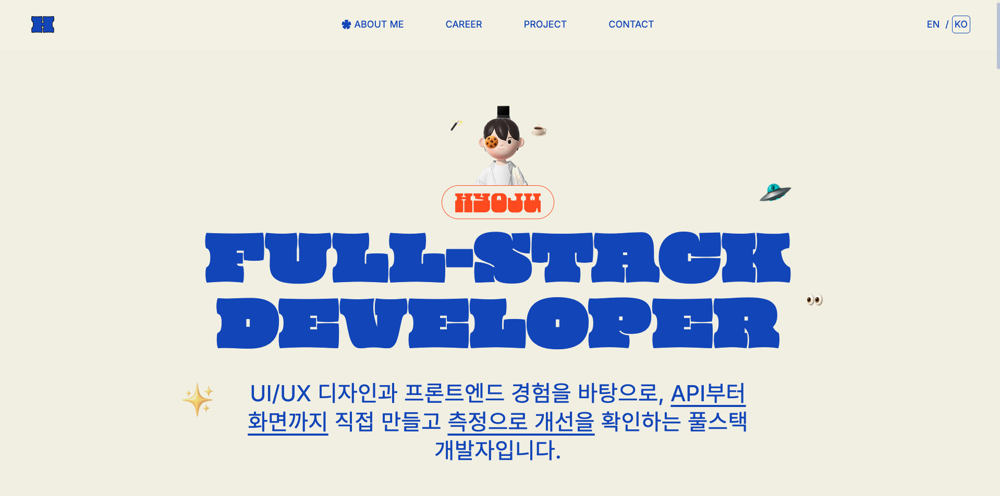

# 2026 Portfolio



한효주의 2026 포트폴리오 원페이지 사이트. React + Vite 기반 SPA이며 한국어/영어를 지원합니다.

배포 주소: [damdadaxx.com](https://damdadaxx.com)

## 기술 스택

- React 19, TypeScript, Vite
- Tailwind CSS v4
- framer-motion (인트로, 스크롤 리빌, 오빗 아이콘 등 인터랙션)
- react-i18next (KO/EN)

## 실행

```bash
npm install
npm run dev       # 개발 서버
npm run build     # 타입체크 + 프로덕션 빌드
npm run preview   # 빌드 결과 미리보기
npm run lint      # oxlint
```

## 폴더 구조

```
src/
  components/
    features/landing/   # Hero, About, Career, Projects, Contact 등 섹션
    ui/                 # Header, Footer, Intro, PillButton 등 공용 컴포넌트
  lib/
    constants/           # nav, socials, projects 등 정적 데이터
    motion/               # 스크롤 리빌 애니메이션 공통 설정
  locales/ko, locales/en  # i18n 번역 리소스
  i18n/                   # i18next 초기화
```

## 주요 기능

- 폰트 로딩 완료 후 헤더/콘텐츠가 드러나는 인트로 애니메이션
- 아바타 주변 장식 아이콘 오빗 인터랙션
- 섹션별 스크롤 진입 시 fade-in + slide-up 리빌
- KO/EN 언어 전환
- 반응형 레이아웃 (`lg:` 1024px 기준)

## 소개된 프로젝트

Projects 섹션(`src/lib/constants/projects.ts`)에 올라가 있는 작업 목록입니다.

| 이름 | 기간 | 기술 스택 | 링크 |
| --- | --- | --- | --- |
| 무빙 (Moving) | 2026.08 ~ 2026.10 | Next.js, TypeScript, TanStack Query, Tailwind CSS, Express, Prisma, PostgreSQL, Supabase Realtime, SSE | [moving-team3.xyz](https://moving-team3.xyz) |
| K-TEST | 2026.06 ~ 2026.09 | Next.js, TypeScript, Zustand, TanStack Query, axios, MediaRecorder API | [ktest.cloud](https://www.ktest.cloud/) |
| 독스루 (Docthru) | 2026.07 | Next.js, React 19, TanStack Query, Tailwind CSS, Express, Prisma, PostgreSQL | [13-doc-thru-team1-fe.vercel.app](https://13-doc-thru-team1-fe.vercel.app) |
| 공부의 숲 (Forest of Study) | 2026.05 ~ 2026.06 | React, React Router, CSS Modules, Express, Prisma, PostgreSQL, Zod | [13-study-forest-team2-fe.netlify.app](https://13-study-forest-team2-fe.netlify.app) |
| 민터스 (Minters) | 2023.05 ~ 2023.09 | Next.js 13, React 18, TypeScript, TanStack Query, Zustand, Tailwind CSS | [reconers.com](https://www.reconers.com/projects/322) |
