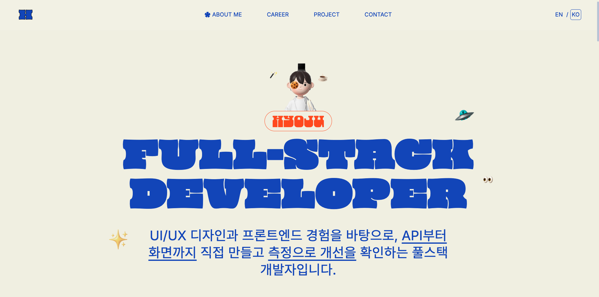

# 2026 HYOJU FULL-STACK DEVELOPER PORTFOLIO



프론트엔드 경력 2년 6개월과 풀스택 부트캠프 경험을 바탕으로, 컴포넌트 설계부터 API·DB, 배포까지 직접 만드는 풀스택 개발자 **한효주**의 2026 포트폴리오입니다. 
한국어/영어를 지원하는 React SPA이며, PC와 모바일 모두 대응합니다.

🚀 배포 주소: [damdadaxx.com](https://damdadaxx.com)

## 사이트 구성

| 경로 | 내용 |
| --- | --- |
| `/` | 메인. 인트로, 히어로, 대표 프로젝트(Moving · K-TEST 티켓), 강점, 일하는 방식, 프로젝트 목록, 연락처 |
| `/project` | 전체 프로젝트 16건. 필터, 무한 스크롤. 케이스 스터디가 있으면 내부 페이지로, 없으면 서비스 링크로 연결 |
| `/project/:slug` | 케이스 스터디 (Moving, K-TEST). 대표 영상, 문제 정의, 해결 과정, 성과 |
| `/about` | 소개, 이렇게 일해요, 지나온 길(커밋 로그 형식), 기술 스택, 교육·수상 |
| `*` | 404 |

## 기술 스택

- React 19, TypeScript, Vite
- Tailwind CSS v4 (디자인 토큰과 폰트는 `src/index.css`)
- framer-motion (인트로, 마스크 텍스트 슬라이드업, 스크롤 리빌, 고정(sticky) 스크롤 섹션)
- react-i18next (KO 기본, EN은 없는 키를 KO로 대체)
- react-router-dom
- Cloudflare Pages 배포 (`wrangler`)

## 시작하기

Node 24 (`.nvmrc`)

```bash
npm install
npm run dev       # 개발 서버
npm run build     # 타입체크 + 프로덕션 빌드
npm run preview   # 빌드 결과 미리보기
npm run lint      # oxlint
npm run deploy    # 빌드 후 Cloudflare Pages 배포
```

## 폴더 구조

```
src/
  pages/                    # HomePage, ProjectPage, ProjectDetailPage, AboutPage, NotFoundPage
  components/
    features/
      landing/              # 메인 섹션 (Hero, Featured, Strengths, Projects, Contact ...)
      project/              # 프로젝트 목록 (ProjectGridCard, ProjectFilter)
        case-study/         # 케이스 스터디 공용 블록과 프로젝트별 에셋
      about/                # About 섹션 (AboutIntro, CareerLog, SkillsList ...)
    ui/                     # Header, Footer, SlideUp, Reveal, Tag, GitChip 등 공용 컴포넌트
  lib/constants/            # nav, socials, projects 등 정적 데이터
  locales/ko, locales/en    # 번역 리소스 (common.json)
  i18n/                     # i18next 초기화
  hooks/                    # usePageView 등
```

## 구현 메모

- **케이스 스터디 구조**: 번역 가능한 문구는 `locales`의 `caseStudy.<id>`에 두고, 이미지·영상 ID 같은 비번역 에셋은 프로젝트별 `*CaseStudy.tsx`에 둡니다. 화면은 공용 `CaseStudyPage` 블록으로 조립합니다. 새 케이스 스터디는 로케일 데이터와 에셋 파일을 만들고 `ProjectDetailPage`의 `CASE_STUDIES`에 등록하면 됩니다.
- **고정 스크롤 섹션**: Featured, Strengths는 `wide:`(94rem 이상)이고 모션 축소 설정이 아닐 때만 스크롤에 고정됩니다. 그 외에는 일반 흐름 레이아웃입니다.
- **영상**: 케이스 스터디 영상은 YouTube nocookie iframe을 무음으로 반복 재생하고, 뷰포트를 벗어나면 일시 정지합니다.
- **번역**: 줄바꿈이 필요한 문구는 `<br />`을 넣고 `<Trans components={{ br: <br /> }}>`로 렌더링합니다.
- **분석**: GA4 `page_view`는 라우트 변경마다 `usePageView`가 직접 보냅니다 (`send_page_view: false`).
- **반응형**: 기본은 모바일, `lg:`(1024px)부터 PC 레이아웃이고 `wide:`는 큰 화면 전용입니다.
- **접근성**: `prefers-reduced-motion`이면 인터랙션을 줄입니다.

## 프로젝트 데이터

`src/lib/constants/projects.ts`에서 프로젝트 목록을 관리합니다. 케이스 스터디가 있는 프로젝트는 `caseStudy: true`로 표시합니다. 프로젝트별 설명, 역할, 분류 문구는 `locales/*/common.json`의 `projects.items.<slug>`에 있습니다.

| 이름 | 비고 |
| --- | --- |
| 무빙 (Moving) | 케이스 스터디 · 코드잇 팀 프로젝트(FE/BE 팀장) |
| K-TEST | 케이스 스터디 · 해커톤 장려상, FE 단독 |
| 독스루, 공부의 숲 | 코드잇 팀 프로젝트 |
| 민터스, 뉴마타, 밀림 외 | 리커너스 재직 시 퍼블리싱·프론트엔드 작업 |

## 연락처

- GitHub: [damdadaxx](https://github.com/damdadaxx)
- LinkedIn: [hyojuhan](https://www.linkedin.com/in/hyojuhan/)
